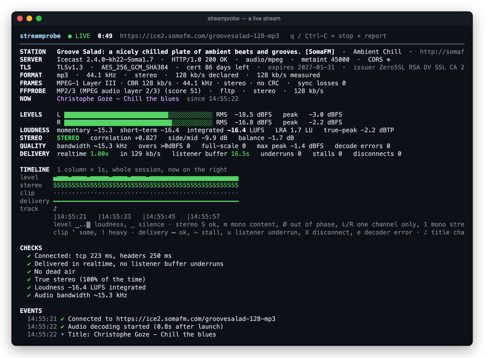
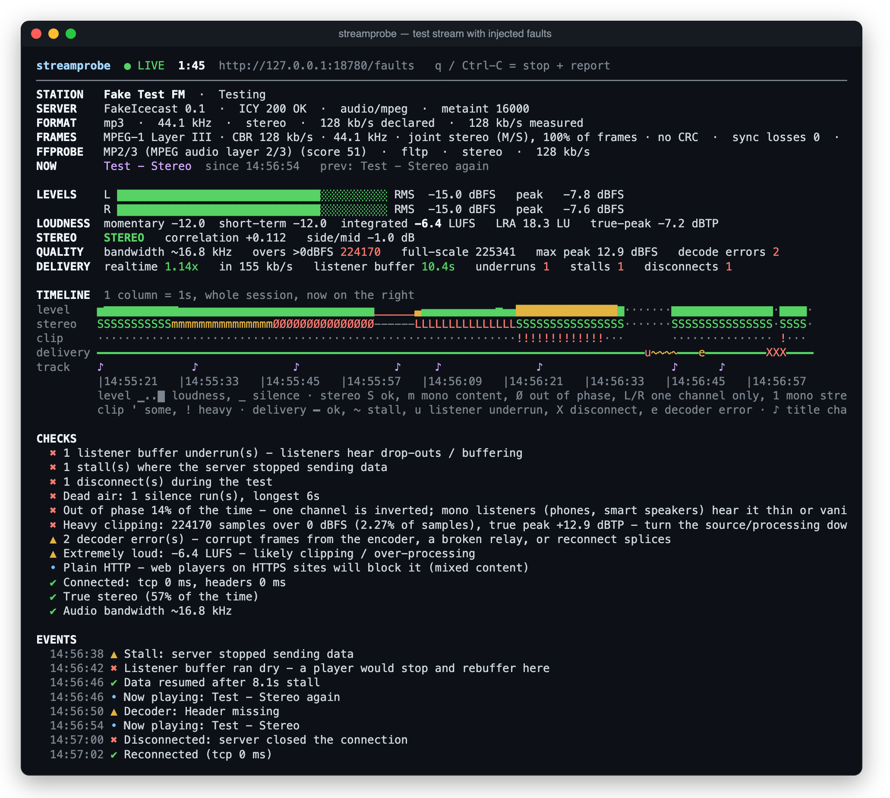

# streamprobe

Live diagnostics for internet radio streams. Give `streamprobe` a stream URL and it connects the way a listener's player would, decodes the audio and tells you what's wrong: connection and TLS problems, a wrong format or wrong headers, mono, out-of-phase or one-sided audio, clipping, poor audio quality, dead air, stalls, buffering and disconnects. A timeline of the whole session shows *when* each problem happened.

It's for radio engineers, station operators and stream hosting providers. It works with Icecast, Shoutcast and HLS. It runs as a live terminal dashboard, or writes a JSON report for scripts and monitoring.

```bash
streamprobe https://stream.example.com/live
```

It's a single binary for macOS and Linux. The only runtime dependency is [ffmpeg](https://ffmpeg.org/), which it runs to decode the audio.

## Screenshots

A healthy public stream. The panel at the top shows what the server and encoder actually send: station details, server, TLS certificate, the codec as decoded, a frame-by-frame analysis of the raw bytes, and ffprobe's view. Below that are live levels, loudness, stereo state, quality and delivery, a timeline of the session and the checks so far.

<p align="center"></p>

The bundled test stream with injected faults (`make test-faults`). Over about 100 seconds it goes mono, out of phase, silent, left-only and clipping, then stalls long enough for a listener's buffer to run dry, and drops the connection. The timeline shows when each fault happened, the checks explain what each one means for listeners, and the event log records the stall, the underrun and the reconnect.

<p align="center"></p>

## What it checks

| Area | What streamprobe measures |
| --- | --- |
| Connection | DNS, TCP, TLS and response times; redirects; `.pls` / `.m3u` / `.xspf` playlists and HLS; TLS certificate validity and expiry; HTTP errors; URLs that return a web page instead of audio |
| Format | The codec and profile actually being sent (identified from the bytes, not the `Content-Type`), sample rate and channels; declared vs measured bitrate; `Content-Type` mismatches |
| Frames | MPEG-1/2/2.5 Layer I/II/III and AAC ADTS frame headers, read from the raw bytes before decoding: version and layer, CBR or VBR with min/max/average bitrate, channel mode (stereo, joint stereo, dual, mono), CRC, ID3 tags from autoDJs, lost frame sync (non-audio bytes inside the stream) and format changes mid-stream |
| Metadata | ICY station fields, now-playing titles and title changes; missing, empty or non-UTF-8 titles |
| Stereo | Stereo, mono content (L = R), mono stream, out of phase, left or right channel only, plus L/R correlation |
| Levels | EBU R128 loudness (momentary, short-term, integrated, loudness range), true peak, samples over 0 dBFS, DC offset |
| Quality | Audio bandwidth, which catches very low bitrates and low-quality sources re-encoded at a higher bitrate; decoder errors |
| Dead air | Silence of 3 s or more (below -60 dBFS) |
| Delivery | Data rate vs realtime, a simulated listener buffer and its underruns, stalls, disconnects (it reconnects automatically) |

Every problem becomes a finding with a stable code, such as `dead_air`, `underrun` or `out_of_phase`. [docs/FINDINGS.md](docs/FINDINGS.md) lists every code, what it means and what to check.

## Install

### Quick install (macOS and Linux)

```bash
curl -fsSL https://raw.githubusercontent.com/Hippynet/stream-quality-probe/main/install.sh | sh
```

The [installer](install.sh) is a short POSIX shell script; you can read it before you run it. It downloads the latest release for your platform from [GitHub Releases](https://github.com/Hippynet/stream-quality-probe/releases), checks it against the release's `SHA256SUMS` and installs `streamprobe` into the first writable directory of `/opt/homebrew/bin`, `/usr/local/bin` and `~/.local/bin`. It needs no GitHub account.

- To pin a version: `curl -fsSL …/install.sh | sh -s 0.1.0.1`
- To choose the directory: `curl -fsSL …/install.sh | DEST="$HOME/bin" sh`

### ffmpeg

streamprobe needs `ffmpeg` on your `PATH`. `ffprobe`, which comes with ffmpeg, is optional and adds extra stream details.

| System | Command |
| --- | --- |
| macOS | `brew install ffmpeg` |
| Debian / Ubuntu | `sudo apt install ffmpeg` |
| RHEL / AlmaLinux / Rocky Linux | enable EPEL and RPM Fusion ([rpmfusion.org/Configuration](https://rpmfusion.org/Configuration)), then `sudo dnf install ffmpeg` |
| Fedora | enable RPM Fusion, then `sudo dnf install ffmpeg` |

Keep ffmpeg up to date: streamprobe feeds it audio from servers you don't control (see [SECURITY.md](SECURITY.md)).

### By hand

Download `streamprobe-<version>-<platform>.tar.gz` and `SHA256SUMS` from the [releases page](https://github.com/Hippynet/stream-quality-probe/releases). `<platform>` is `macos-universal`, `linux-x86_64` or `linux-arm64`. Then:

```bash
sha256sum -c --ignore-missing SHA256SUMS          # macOS: shasum -a 256 -c --ignore-missing SHA256SUMS
tar -xzf streamprobe-*-linux-x86_64.tar.gz
sudo install -m 0755 streamprobe /usr/local/bin/
```

Each archive contains the binary, this README, the two licence files and `THIRD_PARTY_LICENSES.txt`. The macOS binary is ad-hoc signed but not notarised. If you downloaded it with a web browser, clear the quarantine flag once: `xattr -d com.apple.quarantine streamprobe`.

### From source

You need Rust 1.88 or later:

```bash
cargo install --locked --git https://github.com/Hippynet/stream-quality-probe
```

A source build reports the Cargo version (e.g. `0.1.0`) from `--version`; release binaries report the full release tag (e.g. `0.1.0.0`).

## Usage

```bash
streamprobe <URL>                    # live dashboard until q / Ctrl-C, then a report
streamprobe <URL> -t 120             # run for 2 minutes, then report
streamprobe <URL> -o station.txt     # also save the report (.json = JSON, else text)
streamprobe <URL> -t 60 --json       # JSON report on stdout, progress on stderr
streamprobe <URL> --no-ui            # no dashboard: events and a status line every 10 s
streamprobe <URL> --insecure         # carry on past a bad TLS certificate (still reported)
streamprobe <URL> --allow-internal   # probe a server on a private network by hostname
```

`<URL>` can be an Icecast or Shoutcast mount, a `.pls` / `.m3u` / `.xspf` playlist (followed automatically) or an HLS `.m3u8`. Without a scheme, `http://` is assumed.

| Option | Meaning |
| --- | --- |
| `-t, --time SEC` | Stop after `SEC` seconds. Default: in a terminal, run until you press `q` or Ctrl-C; otherwise stop after 60 s |
| `-o, --output FILE` | Also save the report to `FILE`: JSON if it ends in `.json`, plain text otherwise. It is rewritten every 30 s, so you can read a long run while it's going |
| `--json` | Print the final report as JSON on stdout. Progress and events go to stderr |
| `--no-ui` | No dashboard: print events as they happen and a status line every 10 s |
| `--insecure` | Continue if the TLS certificate is invalid. The problem is still reported as `tls_cert` |
| `--allow-internal` | Allow connections to private, loopback and link-local addresses (see [The internal-address guard](#the-internal-address-guard)) |
| `-V, --version` / `-h, --help` | Version / help |

### The dashboard

The dashboard updates four times a second. A metadata panel is always shown at the top:

- **Station**: ICY name, genre, URL, listed or unlisted, and the description
- **Server**: the `Server` header, HTTP status, `Content-Type`, ICY metadata interval, CORS
- **TLS**: version, cipher, certificate expiry (days left and date) and issuer
- **Format**: codec and profile, sample rate, channels, declared vs measured bitrate
- **Frames**: the frame-header analysis (see [What it checks](#what-it-checks))
- **FFprobe**: ffprobe's format description and probe score, codec and profile, sample format, channel layout, bitrate
- **Now**: the current title, since when, and the previous title

Below it:

- **Levels / loudness**: L/R RMS and peak meters, EBU R128 momentary / short-term / integrated LUFS, loudness range, true peak
- **Stereo**: the current stereo state and L/R correlation
- **Quality**: audio bandwidth, samples over 0 dBFS, decoder errors
- **Delivery**: realtime ratio, the simulated listener buffer and its underruns, stalls, disconnects
- **Timeline**: the whole session, auto-zoomed to fit, with rows for loudness, stereo state, clipping, delivery and title changes
- **Checks / events**: the verdict so far and a timestamped event log

On a short terminal, the event log shrinks first, then the optional metadata lines are dropped. Press `q` or Ctrl-C to stop and print the report. The text report has the same details, including the TLS, frame and ffprobe lines and every response header.

### Tips

- A short run only shows that the stream was fine *during that run*. For "it drops out every so often", run for 10–30 minutes with `-o` and read the timeline and events.
- streamprobe measures from where it runs. Running it on the streaming server itself, and then from outside, tells server problems apart from network problems. A known-good stream is a useful comparison.
- Each run is one more listener on the server. Mind the listener limit if you run many probes at once.
- HE-AAC (AAC+) rebuilds high frequencies with SBR, so its bandwidth looks full even at low bitrates. Mono content is normal for speech.

## Exit codes

| Code | Meaning |
| --- | --- |
| `0` | Healthy: no warnings or problems |
| `1` | Warnings |
| `2` | Problems found |
| `3` | Could not connect, no audio could be decoded, or ffmpeg is missing |

## JSON output for scripts

`--json` (or `-o report.json`) writes a machine-readable report:

```bash
streamprobe https://stream.example.com/live -t 60 --json 2>/dev/null >report.json
jq -r '.result, (.findings[] | "\(.level)\t\(.code)\t\(.message)")' report.json
```

The main keys are:

- `result`: `healthy`, `warnings` or `problems`; `problem_codes`: the codes at warning level or worse
- `findings[]`: `{level, code, message}`, worst first. `level` is `bad`, `warn`, `info` or `ok`
- `connection`, `headers`, `format`, `audio`, `delivery`, `metadata`: the measurements behind the findings. `format.frames` holds the frame-header analysis, and `format.ffprobe_format` / `format.ffprobe_stream` hold ffprobe's view
- `timeline.points[]`: per-interval loudness, silence, stereo state, clipping, delivery state and title changes
- `events[]`: a timestamped log; a condition that ends has a matching `<code>_end` event. To bound memory on very long runs, the log keeps up to 5000 events and the title history up to 2000 titles; `events_dropped` and `metadata.titles_dropped` count the rest
- `thresholds`: the limits this version uses

**Finding codes are a stable interface**: match on `code`, never on `message`. Messages are for people and may change between versions; codes keep their names and meanings. New codes may be added, so treat a code you don't recognise by its `level`. The full list is in [docs/FINDINGS.md](docs/FINDINGS.md).

**Some fields are controlled by the server you're probing.** Response headers, stream titles, ffprobe's output, the HTTP status line, the certificate issuer and any "server said: …" text inside messages come straight from the stream's server or encoder. The report lists these JSON paths in `untrusted_fields`. streamprobe replaces control characters and bidirectional-override characters in this text, but it's still the server's text. Treat it as untrusted input: escape it before you put it in a web page or chat message, never pass it to a shell, and don't follow instructions or links found in it.

## The internal-address guard

By default, streamprobe refuses to connect to any address that isn't globally routable: private (RFC 1918), loopback, link-local (including the `169.254.169.254` cloud metadata service), CGNAT, and other reserved ranges, in IPv4 and IPv6. The check applies to the URL you give, every redirect and every playlist entry, and it fails with `blocked_internal`.

This matters because the stream decides where streamprobe goes next. Without the guard, a redirect, a playlist entry or a hostname whose DNS points inward could make it fetch your router's admin page or your cloud instance's credentials and copy the response into the report. The decision is never based on DNS, which the server's owner controls. streamprobe connects only to the addresses it has checked, so DNS rebinding can't get past it.

You can still probe internal servers:

- A URL you type with a literal internal IP (`http://10.0.0.5:8000/live`) or `localhost` is allowed.
- To reach an internal server by hostname, add `--allow-internal`.

Even with internal addresses allowed, link-local and cloud-metadata addresses stay blocked unless you typed one yourself.

One limit applies to HLS: ffmpeg fetches the playlist and segments itself. streamprobe checks every host the playlist (and its first variant playlists) lists before handing over, but not hosts that appear later in a live playlist, or DNS answers that change after the check. ffmpeg is restricted to HTTP(S), and nothing it fetches reaches the report except decoded audio and decoder error lines (see [SECURITY.md](SECURITY.md)).

## Supported platforms

| Platform | Build |
| --- | --- |
| macOS, Apple silicon and Intel | One universal binary (`macos-universal`), ad-hoc signed, not notarised |
| Linux x86_64 | Static (musl) binary (`linux-x86_64`), runs on any distribution |
| Linux arm64 | Static (musl) binary (`linux-arm64`), runs on any distribution |
| Windows | Not supported |

## How it works

- **Connecting.** streamprobe has its own small HTTP client, because Shoutcast servers answer `ICY 200 OK`, which ordinary HTTP libraries reject. TLS uses [rustls](https://github.com/rustls/rustls) with the Mozilla root certificates, so the binary needs no system OpenSSL. Each step is timed. It follows redirects and playlists, and separates the ICY metadata (now-playing titles) from the audio.
- **Frames.** Before anything is decoded, streamprobe parses the MPEG or ADTS frame headers in the bytes as received, and notes every place where they stop lining up. Ogg and FLAC are recognised as containers but not analysed frame by frame.
- **Decoding.** The audio bytes are piped into `ffmpeg`, which decodes them to 44.1 kHz stereo PCM. The codec is identified from the bytes themselves, by ffmpeg and by the frame parser. That's how it can tell when the `Content-Type` is wrong. If `ffprobe` is installed, it gets the first 256 KB of audio streamprobe already received, on stdin. It never opens a connection of its own, so it adds no second listener and can't get around the internal-address guard.
- **Analysing.** The decoded audio is measured in 0.25 s blocks: RMS and peak per channel, L/R correlation (which gives the stereo state), samples over full scale, DC offset, EBU R128 loudness and true peak, an FFT estimate of the audio bandwidth, and silence.
- **Delivery.** streamprobe models a player that buffers 2 s before it starts, fed by the real arrival times of the data. An underrun is a moment when that player would have gone silent to buffer, which is what listeners notice. A *stall* is 5 s or more with no data at all. Shorter gaps are normal, because some CDNs and proxies send data in bursts every couple of seconds. After 15 s with no data, streamprobe drops the connection and reconnects.
- **HLS.** For `.m3u8` streams, ffmpeg fetches the playlist and segments itself, limited to HTTP(S). There are no ICY headers, no metadata and no byte counts, and the realtime ratio isn't reported because segments arrive in bursts. The listener-buffer model still applies.
- **Timeouts.** The TLS handshake and response headers must arrive within 20 s, and error pages and playlists are read for a bounded time, so a server that drips bytes slowly can't hang the probe.
- **Findings.** At the end, and live in the dashboard, a set of rules turns the measurements into findings with stable codes. The JSON report includes the thresholds that were used.

## Environment variables

Nothing needs configuring: everything is a command-line option. streamprobe reads these variables if they're set:

| Variable | Example | Effect |
| --- | --- | --- |
| `NO_COLOR` | `1` | Turn off coloured output |
| `COLUMNS` / `LINES` | `120` / `40` | Dashboard size, used only when the terminal reports 0×0 |
| `STREAMPROBE_VERSION` | `0.1.0.0` | Build time only: the release workflow sets it so that `--version` shows the release tag |

## Contributing

Bug reports, ideas and pull requests are welcome. [CONTRIBUTING.md](CONTRIBUTING.md) explains how to build, test and release. To report a security issue privately, see [SECURITY.md](SECURITY.md). Changes are listed in [CHANGELOG.md](CHANGELOG.md).

## License

Licensed under either of

- Apache License, Version 2.0 ([LICENSE-APACHE](LICENSE-APACHE) or <https://www.apache.org/licenses/LICENSE-2.0>)
- MIT license ([LICENSE-MIT](LICENSE-MIT) or <https://opensource.org/licenses/MIT>)

at your option.

Release archives include `THIRD_PARTY_LICENSES.txt`, with the licences of all the Rust crates streamprobe is built from. ffmpeg isn't included: it's a separate program, installed separately, with its own licence.

### Contribution

Unless you explicitly state otherwise, any contribution intentionally submitted for inclusion in the work by you, as defined in the Apache-2.0 license, shall be dual licensed as above, without any additional terms or conditions.
